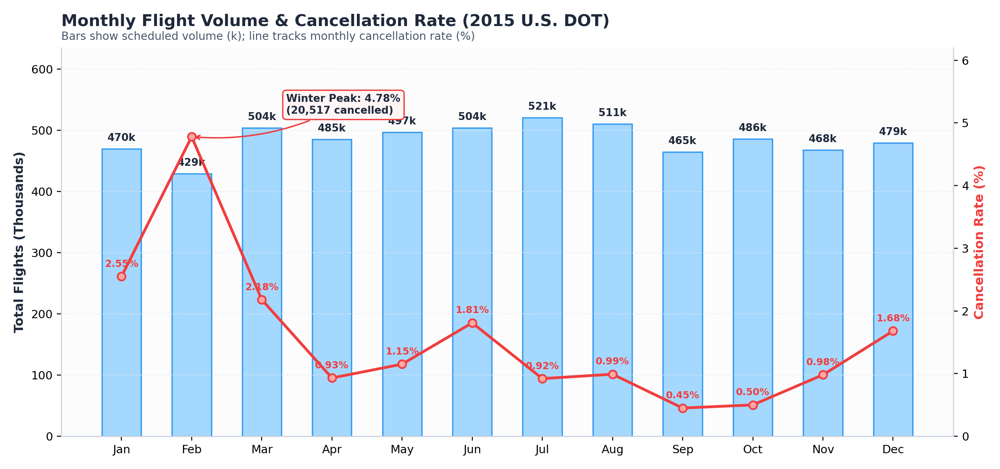

# Airline Delay Analysis

An end-to-end analysis of **5.8 million U.S. domestic flights from 2015**, exploring flight delays, on-time performance, cancellations, airlines, and airports.



> **Dataset:** [2015 Flight Delays and Cancellations on Kaggle](https://www.kaggle.com/datasets/usdot/flight-delays) - collected and published by the U.S. Department of Transportation's Bureau of Transportation Statistics. Download the source files there; the raw and processed dataset files are intentionally excluded from this repository.

## Contents

- [Project overview](#project-overview)
- [Key findings](#key-findings)
- [Repository layout](#repository-layout)
- [Tools and workflow](#tools-and-workflow)
- [Reproducing the analysis](#reproducing-the-analysis)
- [Limitations](#limitations)

## Project overview

This project combines Python data processing and exploration, SQLite analysis, visualizations, a written report, and Power BI summary outputs to examine U.S. flight operations during 2015.

## Key findings

- **Flight status:** 5,714,008 flights completed (98.19%), 89,884 were cancelled (1.54%), and 15,187 were diverted (0.26%).
- **On-time performance:** 81.39% of completed flights arrived less than 15 minutes late.
- **Arrival delays:** Average arrival delay was 4.41 minutes; the median was 5 minutes early.
- **Delay minutes:** Late aircraft and airline-related issues accounted for over 72% of recorded delay minutes among flights delayed by 15 minutes or more.
- **Cancellations:** Weather was the most frequently recorded cancellation cause (54.35%), followed by airline/carrier issues (28.11%).

See the [business insights](reports/business_insights.md) and [full PDF report](reports/airline_delay_analysis_report.pdf) for more detail.

## Repository layout

```text
dataset/          Local raw and processed data (ignored by Git)
notebooks/        Jupyter exploration and analysis
powerbi/          Power BI dashboard and summary exports
reports/          Business insights and PDF report
sql/               Documented analysis queries
visualizations/   Exported charts
README.md
```

The source dataset is not stored here. Download it from Kaggle using the link above. Locally generated files under `dataset/raw/` and `dataset/cleaned/` are ignored by Git.

## Tools and workflow

- **Python:** chunked data processing, Parquet, exploration, and chart generation
- **SQLite and SQL:** KPI, ranking, trend, and delay analysis
- **Matplotlib and Seaborn:** visualizations in [`visualizations/`](visualizations/)
- **Power BI:** dashboard in [`powerbi/US_Flight_Performance.pbix`](powerbi/US_Flight_Performance.pbix) and prepared summary exports
- **Reports:** [business insights](reports/business_insights.md) and [PDF report](reports/airline_delay_analysis_report.pdf)

## Reproducing the analysis

1. Download the Kaggle dataset and place its source CSV files in `dataset/raw/`.
2. Follow the notebook workflow in [`notebooks/01_Dataset_Exploration.ipynb`](notebooks/01_Dataset_Exploration.ipynb) to explore and process the data.
3. Create the cleaned outputs and SQLite database under `dataset/cleaned/`, then run the scripts in [`sql/`](sql/).
4. Use the notebook workflow to regenerate charts and reports. Load the prepared CSVs or the Power BI file from [`powerbi/`](powerbi/) in Power BI Desktop.

## Limitations

- The dataset covers **historical U.S. domestic flights in 2015**; it does not describe current airline operations or Indian flights.
- The records describe flights, not individual passengers, so passenger headcount is not measured.
- Some airport identifiers are numeric DOT codes rather than IATA codes. The project documents this and preserves those rows in overall, airline, and monthly metrics; airport lookup analyses may only include matched codes.
- The dataset is hosted on Kaggle and is not included in this repository. Its source and license information are available on the [dataset page](https://www.kaggle.com/datasets/usdot/flight-delays).
